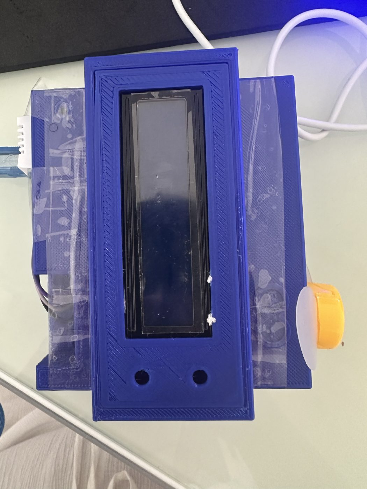
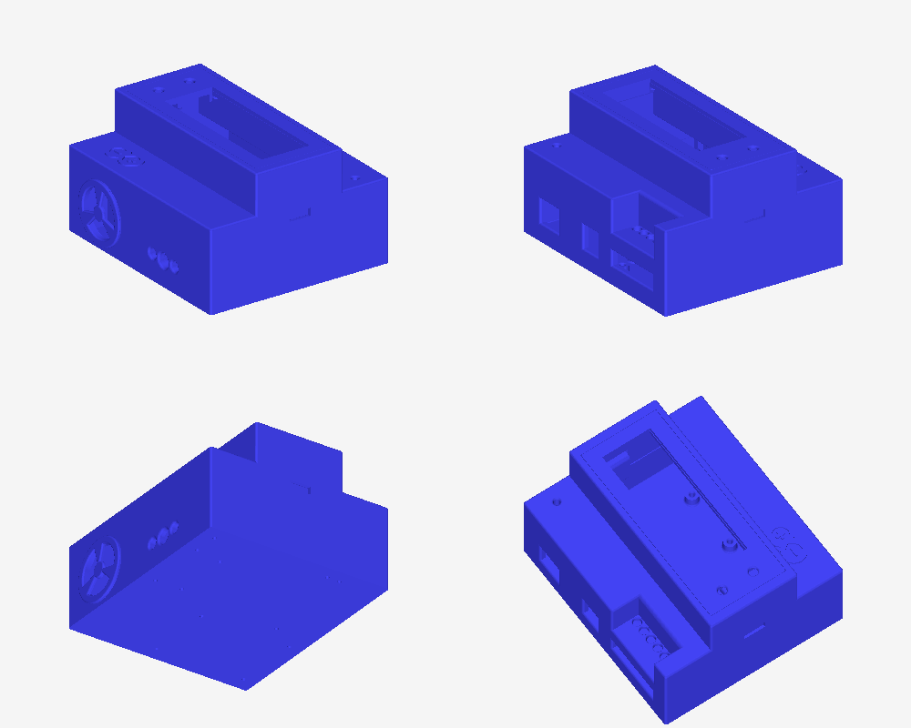
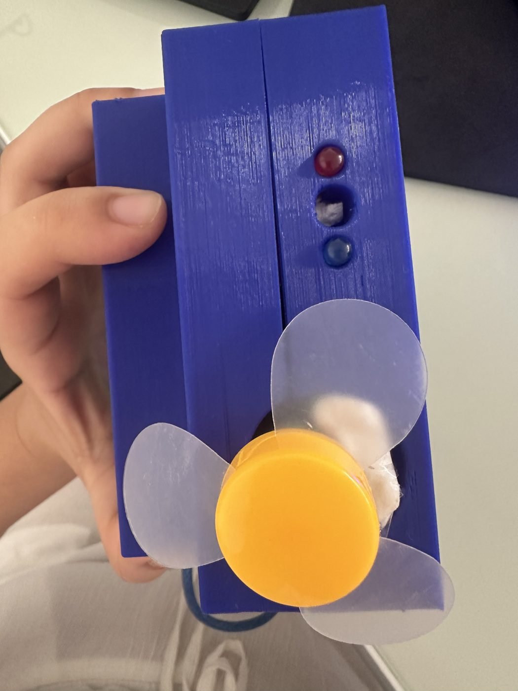
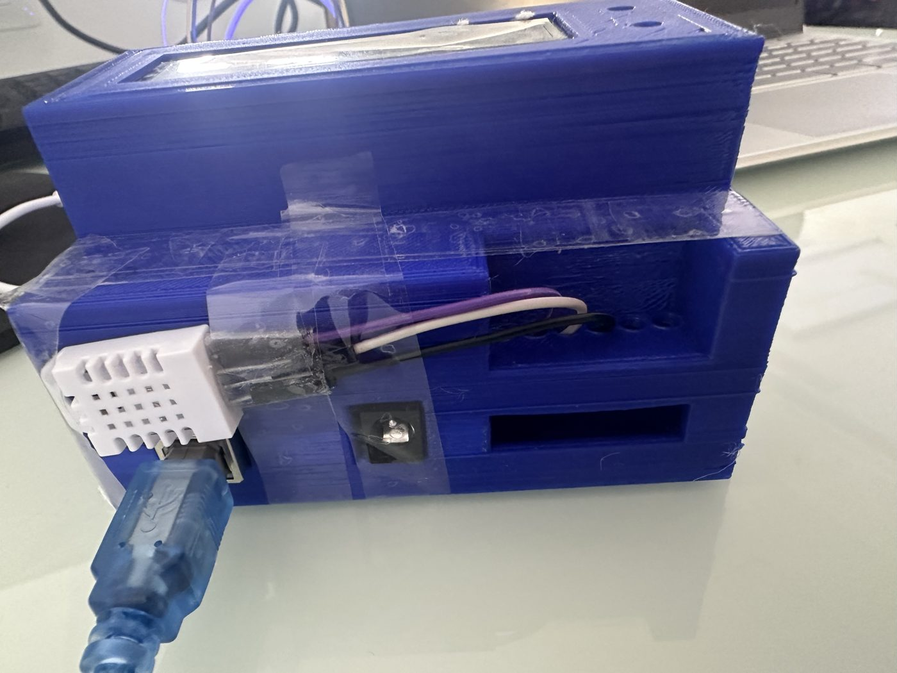

# Surveillance de température

Projet d'électronique sur Arduino (Université Côte d'Azur, 2025) : un capteur DHT22 mesure la température, un écran LCD l'affiche, et une LED et un buzzer signalent le dépassement d'un seuil.



## État du projet

Le prototype a été rendu à l'université avec sa carte Arduino, et une partie des fichiers a été perdue lors d'un changement d'ordinateur. Ce dépôt reconstitue le projet à partir de ce qui a été conservé : une version du code utilisée sur la carte, le boîtier 3D que j'ai dessiné, les photos et la fiche du projet.

Le modèle du boîtier est dans `cad/boitier.stl`.



## Ce que fait le code conservé

`firmware/surveillance_temperature/surveillance_temperature.ino` :

- lit la température toutes les 2 secondes environ et l'affiche sur le LCD I2C ;
- au-dessus de 30 °C, allume la LED rouge (D8) et le buzzer (D10) ;
- sinon, allume la LED bleue (D9) ;
- affiche un message si le capteur ne répond pas (DHT22 sur D2).

## Écarts avec la fiche du projet

La fiche d'origine prévoyait aussi l'affichage de l'humidité et du seuil, un seuil de 38 °C et la commande d'un ventilateur, visible sur les photos. Le prototype d'origine fonctionnait, mais le code du ventilateur n'a pas été conservé : la version retrouvée ne contient rien de tout cela.

## Limites connues de la version conservée

- Si le capteur tombe en panne, les sorties gardent leur dernier état.
- Le message « Systeme Demarre... » dépasse les 16 caractères de l'écran.
- Il n'y a pas d'hystérésis : l'alerte peut basculer sans arrêt autour du seuil.

## Reconstitution avec ventilateur

`firmware/version_ventilateur` reconstitue le fonctionnement prévu par la fiche : ventilateur, seuil de 38 °C, affichage de la température, de l'humidité et du seuil.

Deux ajouts par rapport à la fiche :

- le ventilateur s'arrête à 36 °C au lieu de 38 °C, pour éviter qu'il bascule sans arrêt autour du seuil ;
- après 3 lectures ratées, le système passe en mode sécurité : alerte et ventilateur.

### Lancer la simulation

```
cd simulation
make test
```

`simulation/simulateur.cpp` exécute le vrai firmware sur PC avec une fausse carte et un modèle thermique simple. Il vérifie 15 points et écrit une trace dans `simulation/build/trace.csv`.

| Scénario | Résultat attendu et vérifié |
|---|---|
| 10 minutes à 25 °C | LED bleue seule, ventilateur arrêté |
| Échauffement | Le ventilateur démarre moins de 2,2 s après le passage de 38 °C, et la température reste sous 39 °C |
| Mesure qui oscille entre 37,7 et 38,3 °C | Pas de basculement en boucle |
| Panne du capteur | Mode sécurité après 3 lectures ratées, retour à la normale ensuite |
| Ventilateur sans effet | L'alerte reste active pendant que la température monte |

### Validation

La logique a été validée en simulation et le programme compile pour Arduino Uno. Cette reconstitution n'a pas été exécutée sur la carte physique. Les constantes du modèle thermique sont choisies pour l'exemple.

### Essayer sur Wokwi

`simulation/wokwi` contient un schéma pour le simulateur en ligne [Wokwi](https://wokwi.com), où une LED cyan remplace le ventilateur. Pour l'utiliser, crée un projet Arduino Uno, puis copie `diagram.json`, `libraries.txt`, le fichier `.ino` et `controle.h`. Ce schéma n'a pas encore été essayé.

## Photos




